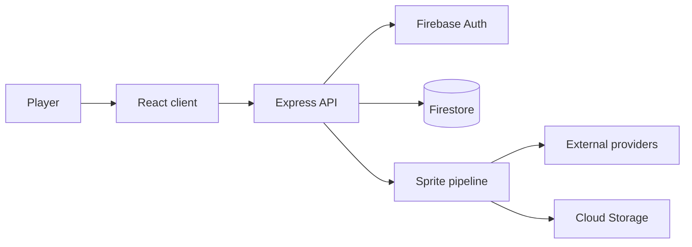

# Sprout Web

<div align="center">

  <picture>
    <source media="(prefers-color-scheme: dark)" srcset="docs/brand/sprout-wordmark-cream.png">
    
  </picture>

**Scan a real plant. Get a creature. Battle with it.**


*These demo creatures were rendered by this repository's pipeline using species-name prompts.*

[Upstream demo](https://sprout-web-app-jet.vercel.app) · [Local setup](#local-setup) · [Architecture](#stack-and-architecture) · [Documentation](#documentation)

</div>

Sprout Web turns plant photographs into collectible creatures. Players scan a
plant, keep its creature in an archive, and use it in turn-based battles. A
public almanac connects the game to plants found in Singapore.

This is a collaborative SUTD coursework project and a public fork of
[Kopi-O-Kosong-Beng/sprout-web-app](https://github.com/Kopi-O-Kosong-Beng/sprout-web-app).
The fork retains local development and has diverged from upstream. The linked
demo belongs to the upstream team project; its availability is separate from
this source checkout.

## What you can do

- Scan a plant photo through species identification, prompt creation, sprite
  generation, background removal, finishing, and creature assembly.
- Save discoveries with botanical metadata and species-derived battle stats.
  Repeated scans update the existing species record.
- Fight the fixed Thornback opponent in PVE battles with quick, guard,
  signature, and heal moves. The server owns battle outcomes and progression.
- Compare XP and discovery rankings, or browse the public plant almanac.
- Use verified accounts, contact tickets, and permission-gated operator pages.

## Stack and architecture

| Technology | Role in this project |
|---|---|
| React, React Router, and Vite | The browser client has separate public, player, and operator routes. Vite builds the static frontend. |
| TypeScript | Models API data, pipeline events, and battle state across the client and server workspaces. |
| Express and Node.js 22 | The API verifies accounts, applies game rules, and streams pipeline progress through server-sent events. Provider credentials stay here. |
| Firebase Auth, Firestore, and Cloud Storage | Auth identifies players, Firestore stores game records, and Storage holds generated sprites. Emulator-backed tests exercise the persistence boundary. |
| Plant.id, Gemini, NVIDIA, and background-removal providers | Separate pipeline stages identify plants, craft prompts, render creatures, and produce cutouts. Mock mode supports local tests without paid calls. |
| sharp | Validates image input and performs local sprite processing. Its native dependency is part of the container build. |
| Docker, Vercel, and Render | Compose runs local infrastructure. The deployment configuration separates a static frontend from the containerized API. |



The client presents game state while the server owns rules, persistence, and
provider access. The workspaces connect typed browser interfaces to a stateful
game and an external image pipeline, with separate tests for each boundary.

### Engineering details

- The [battle engine](server/services/battle-engine.ts) uses a seeded random
  sequence. [Persistence validation](server/repositories/battle-replay.ts)
  reconstructs the session and rejects state that differs from deterministic
  replay. Web healing is a battle move with its own rules; the native Android
  game's three-heal system is a separate implementation.
- The [image ingest gate](server/pipeline/ingest/imageIngest.ts) checks format,
  size, dimensions, and decodability before provider calls. The
  [fuzzing notes](md/FUZZ_TESTING.md) describe mutation-based coverage.
- [Liveness, readiness, and shutdown handling](md/CONTAINERIZATION.md) separate
  a running process from available backing services. The Storage readiness
  check verifies configuration, not a live upload.

## Local setup

For the container setup, install Docker with Compose:

```bash
git clone https://github.com/Neonat/sprout-web.git
cd sprout-web
docker compose up --build
```

Open the [frontend](http://localhost:5173),
[API liveness](http://localhost:3001/api/health), or
[API readiness](http://localhost:3001/api/health/ready).

Compose starts the client, API, and Firestore emulator with
`USE_MOCK_APIS=true` and console mail. It leaves Storage unconfigured, so
readiness reports `not_ready` and scans cannot finish the sprite-upload step.
Firebase login and a complete scan-to-archive flow also need Auth and client
Firebase configuration.

For a full local player flow, follow the
[development guide](docs/DEVELOPMENT.md),
[client environment example](client/.env.example), and
[server Firebase setup](server/FIREBASE_SETUP.md). Use this fork's clone URL
when following the upstream guide. Direct workspace development requires
Node.js 22; the guide covers configuration, seeding, and emulator prerequisites.
Provider keys belong on the server.

## Checks

Run workspace checks from the repository root after installing dependencies
with `npm ci`:

```bash
npm test
npm run typecheck -w server
npm run typecheck -w client
npm run lint -w client
npm run test:e2e
```

`npm test` runs server Jest tests against the Firestore emulator, pipeline
Vitest tests, and client Vitest tests with React Testing Library. Playwright
starts the real client and API with Auth, Firestore, and Storage emulators;
external providers use fixtures. See the
[test traceability guide](docs/TEST_TRACEABILITY.md) and
[command reference](docs/COMMANDS.md) for suite scope and prerequisites.

## Limitations

- Compose alone does not provide a complete authenticated scan flow.
- Provider output quality and live email delivery require separate validation.
  The documented upstream mail setup limits delivery to one address.
- PVP has design material but no implemented player-versus-player mode.
- Operator access checks have automated coverage; complete authorized operator
  journeys and some account and ticket flows still lack browser coverage.
- The committed demo creatures above were generated from species-name prompts.
  They are not evidence of photograph-conditioned generation. Optional
  reference photos are absent from this checkout.

## Documentation

| Guide | Contents |
|---|---|
| [Development](docs/DEVELOPMENT.md) | Local configuration, seeding, and troubleshooting. |
| [Client](client/README.md) | Frontend commands, source layout, and environment setup. |
| [Commands](docs/COMMANDS.md) | Workspace scripts and operational commands. |
| [Test traceability](docs/TEST_TRACEABILITY.md) | Use cases, diagrams, and test suites. |
| [Container design](md/CONTAINERIZATION.md) | Image build, probes, shutdown, and operating limits. |
| [Deployment](md/DEPLOYMENT.md) | Hosting, environment variables, and CORS. |
| [Submission](docs/final-submission/) | Group report and evidence map. |
| [Operational measurements](docs/DELL_METRICS.md) | Historical measurements and their context. |

## Related work and recognition

Sprout explores plant diversity and tourism through plant discovery and
collectible creatures. The
[Android game](https://github.com/Neonat/sprout-android) is a Java implementation
with independent Expo and API ports. The private
[operations studio](https://github.com/Neonat/sprout-studio) and
[earlier browser prototype](https://github.com/Neonat/sprout-web-prototype)
have separate histories and require access.

The [public project summary](https://www.linkedin.com/in/nathaniel-sim/details/experience/)
records best-project awards in SUTD 50.001 Information Systems and Programming
and 50.003 Elements of Software Construction, a S$2,000 Baby Shark Fund grant,
and the Dell Book Prize with a S$1,500 cash award. These recognize Sprout and
its project teams across its development, rather than this fork alone.

## Team

Built by Cohort 3, Team 2 for **50.003 Elements of Software Construction** at the
Singapore University of Technology and Design, May to August 2026.

| Member | Focus |
|---|---|
| **Andrina Morrison** | Requirements and use cases, class and sequence diagrams, report compilation, sustainability and inclusion |
| **Justin Teh** | Use case model, auth and contact surfaces, presentation |
| **Ng Li Xiang** | Class and sequence diagrams, scan and archive interfaces |
| **Nathaniel Sim** | GenAI pipeline, developer platform, robustness fuzzing, testing |
| **Omar Fayaz** | Sequence diagrams, archive and upload interfaces |
| **Chia Zhi Feng** | Backend and infrastructure, testing, deployment, release review |

Ownership above is the baseline the team agreed on 31 July 2026. Per-feature
attribution is in the pull request history.

## Copyright

© 2026 the six authors listed above. All rights reserved.

The upstream project was private coursework and carries no licence. This
public reference fork preserves the authors' copyright notice; public
visibility does not grant a licence for use, modification or redistribution.
